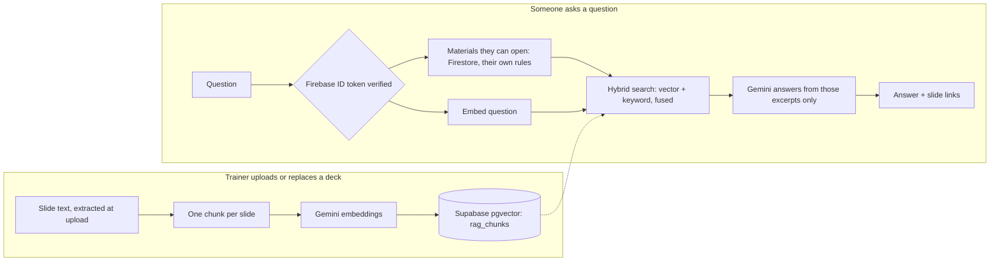

# Training assistant (RAG)

Anyone signed in can ask a question and get an answer drawn only from the
training material **they're allowed to open**, with links to the exact slides.
Open it from the ✨ chat button in the bottom-right corner. Inside a deck or
video it answers about that material, or switch to **All training**.

## How it works



| Piece | File |
|---|---|
| Schema, hybrid search, lockdown | `supabase/migrations/20261020_ai_assistant.sql` |
| Ask / index API (index status: `GET /api/rag/index`) | `app/api/ask/route.js`, `app/api/rag/index/route.js` |
| Who-sees-what (shared with the browser) | `lib/audience.js` |
| Token check + allowed materials | `lib/server/viewer.js`, `lib/server/firestore.js` |
| Gemini calls | `lib/server/ai.js` |
| Chunking, prompt | `lib/rag/chunk.js`, `lib/rag/prompt.js` |
| UI (chat button + window) | `components/AskAssistant.js` |

Keyword search runs next to vector search because this material is full of
exact labels (`Customer wants AWB?`, `Cancel override`, `W - Invalid claim`)
that embeddings alone match poorly.

## Access control

- **Retrieval is filtered, not the model.** On every question the server lists
  the materials the asker can open by querying Firestore *with their own ID
  token*, so `firestore.rules` decide, then searches only those. A seller can't
  reach Revibe-agent material, prompt injection included: the model only ever
  sees excerpts the person could already open in the library.
- Chunks store no audience, so changing a category's audiences takes effect
  immediately, with no re-index.
- Supabase: RLS on with no policies, and the functions are revoked from
  `anon`/`authenticated`, so the public anon key can't read or search chunks.
  Only the server's service-role key can.
- `GEMINI_API_KEY` and `SUPABASE_SERVICE_ROLE_KEY` live in `lib/server/*`,
  which imports `server-only`, so a client import fails the build.

## Setup (one time)

1. **Supabase → SQL Editor:** run `supabase/migrations/20261020_ai_assistant.sql`.
2. **Environment variables** (Vercel → Settings → Environment Variables, and `.env.local`). Never prefix them with `NEXT_PUBLIC_`.

   | Variable | Where to get it |
   |---|---|
   | `GEMINI_API_KEY` | Google AI Studio → API keys |
   | `SUPABASE_SERVICE_ROLE_KEY` | Supabase → Project Settings → API keys (secret key) |
   | `GEMINI_CHAT_MODEL` *(optional)* | Defaults to the rolling `gemini-flash-latest` alias. Set a fixed model ID to freeze behaviour. |

3. Redeploy, then open the **Library** as a trainer. It indexes every material
   the assistant can't search yet (uploaded before it existed, or whose sync
   failed) in the background. New uploads, re-uploads and deletes keep the index in
   sync on their own. **Library → ⋯ → Rebuild assistant index** re-reads everything.

Until steps 1–2 are done the chat button stays hidden (`GET /api/ask` returns `{ ready: false }`).
If every answer says it can't read any training material yet, the index is empty: open the Library as a trainer.

## Finding gaps in the training material

Every question is logged to `rag_queries`. Questions it couldn't answer are
the material's gaps:

```sql
select question, count(*) as times, max(created_at) as last_asked
from rag_queries
where not answered and created_at > now() - interval '30 days'
group by question
order by times desc
limit 50;
```

## Limits and next steps

- Each person can ask 30 questions per 10 minutes (counted from `rag_queries`;
  `LIMIT_QUESTIONS` in `app/api/ask/route.js`), so a loop can't run up the AI
  bill. Trainers aren't limited.
- Text comes from the upload-time extraction: the first 50 pages per file
  (`TEXT_PAGE_LIMIT` in `lib/thumbnails.js`). Text inside screenshots isn't read.
- A video is searchable through its description (e.g. the steps it walks
  through), not its audio. Add a transcript to the description to cover more.
- Exact vector search is fine to roughly 50k chunks. Past that, add the HNSW
  index described in the migration.
- Another provider means changing `embedTexts` and `generateJson` in
  `lib/server/ai.js`. A different embedding size also means changing
  `vector(768)` in the migration and rebuilding the index.
